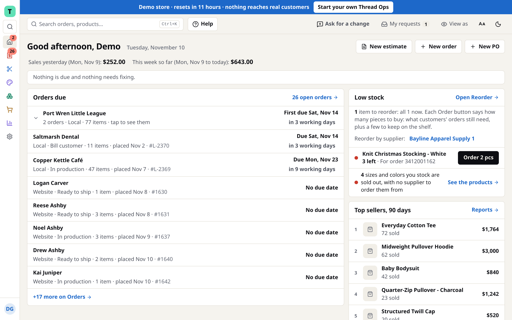
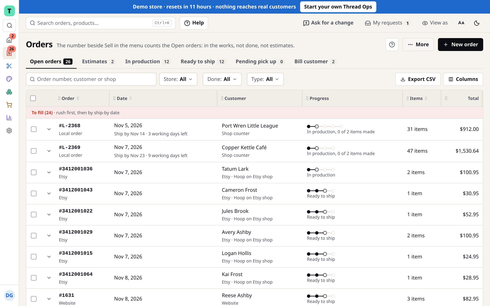
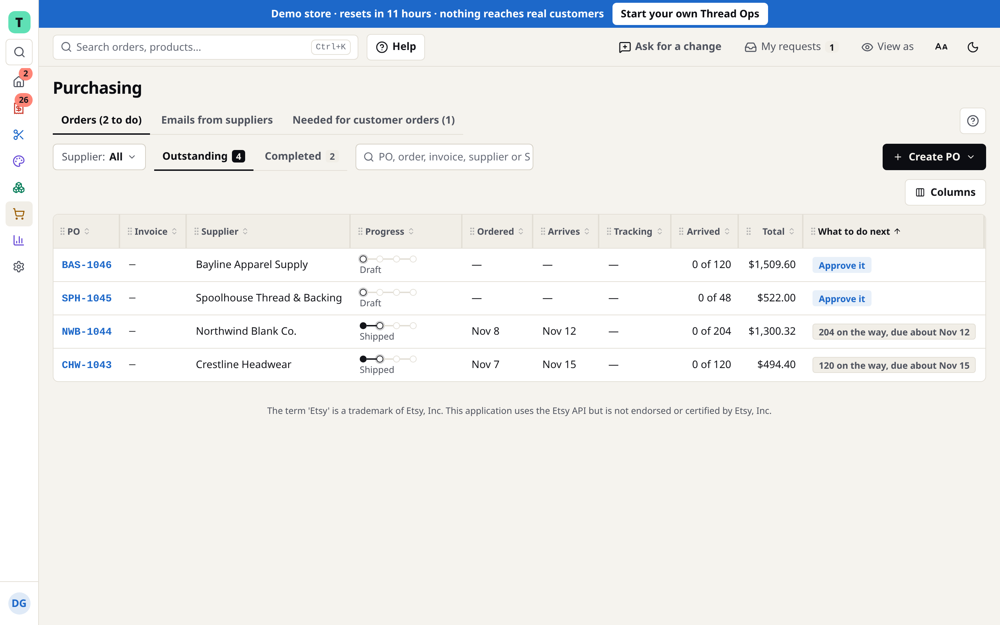
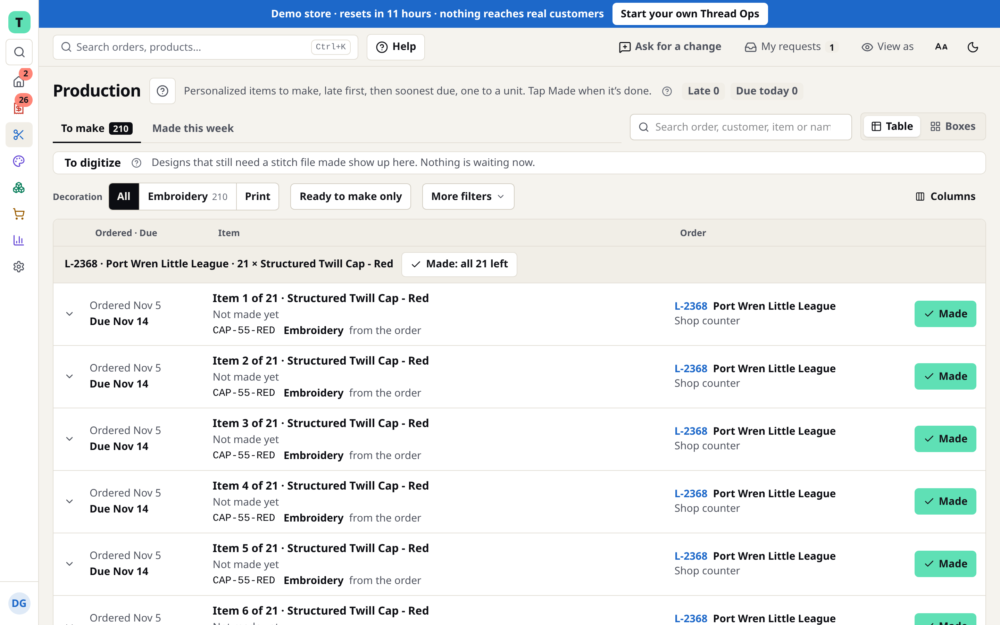

## Applied AI builder and technical implementation lead

I build systems that let AI agents do real work safely, and I get people using them.

**What I work on**

- **Agent tooling.** I wrote the MCP server that AI agents use to run a real store's day-to-day operations: scoped keys that decide which tools an agent can even see, a flow for agents to ask for access instead of guessing, and a contract test for every tool. The generic core is public: [mcp-agent-tools-core](https://github.com/Sotired001/mcp-agent-tools-core).
- **Thread Ops.** A production operations platform for apparel decoration shops (inventory, purchasing, pricing, orders), with a Rust backend, a React and TypeScript front end, and Shopify, Etsy and supplier integrations. Live with its first customer.
- **Running teams of coding agents.** I direct Claude Code and Codex in parallel worktrees behind automated check gates and post-deploy tests. More than 8,000 commits from first commit to production in under eight months. The workflow, extracted and simplified, is public: [coding-agents-kit](https://github.com/Sotired001/coding-agents-kit).

**Thread Ops, running**

The code is private, so here it is on its demo store. Every name and number below is made up.

<table>
  <tr>
    <td></td>
    <td></td>
  </tr>
  <tr>
    <td align="center">Home: what is due, what is low, what sells</td>
    <td align="center">Orders from the counter, Etsy and the website in one list</td>
  </tr>
  <tr>
    <td></td>
    <td></td>
  </tr>
  <tr>
    <td align="center">Purchasing: each order says what to do next</td>
    <td align="center">Production: one row per piece to make</td>
  </tr>
</table>

**Before this**

Three years deploying election technology for government offices: onsite rollouts, go-lives on deadlines that could not move, training client staff, and leading up to 70 field contractors at a time.

**Tools**

Rust, TypeScript, React, SQLite, Linux, self-hosted infrastructure, Model Context Protocol, Claude Code, Codex, locally hosted models.

Open to roles in AI deployment, implementation and agent tooling. Remote, or willing to relocate and travel.
